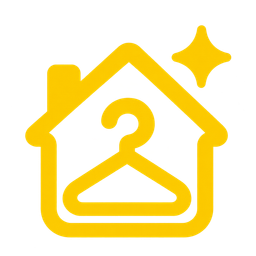

# Klean Ur Mind — Website Layout

## Shared page structure

1. Accessible “Skip to content” link.
2. Development notice when demo authentication is enabled in development.
3. Header with business logo, name, CARE & WASH tagline, location, navigation, and booking button.
4. Main content area containing the current page.
5. Footer with business branding, service links, support links, and copyright.

## Business logo and icons



| Asset | File | Size / usage |
| --- | --- | --- |
| Original logo | `logo.png` | Original supplied image |
| Website logo | `public/images/logo.png` | 256 × 256 PNG; displayed at 56 × 56 in header and footer |
| Browser favicon | `app/favicon.ico` | 16, 32, and 48 pixel variants |
| App icon | `app/icon.png` | 192 × 192 PNG |
| Apple home-screen icon | `app/apple-icon.png` | 180 × 180 PNG with white background |

Next.js automatically registers icons using its app-directory metadata conventions.

## Header

- Logo and business name link to the home page.
- Location: Kozhikode, Kerala.
- Navigation: Home, Book a Service, My Bookings, Admin.
- Primary action: Book a Service.
- White background; content container has a maximum width of 1240 pixels.

## Home page sections

1. Hero: “A clean home. A lighter mind.” with booking and bookings links, service information, and a living-room image.
2. Service cards: Home Cleaning, Doorstep Laundry, Cleaning + Laundry.
3. Service coverage checker.
4. How it works: Choose Your Service, Request a Time, Approve Your Quote.
5. Care and coordination information with a laundry image.
6. Frequently asked questions.
7. Final service booking call to action.

## Footer

Three columns on desktop:

- Branding: logo, business name, and “A clean home. A lighter mind.”
- Our services: home cleaning, laundry pickup and return, and combined service.
- Here to help: bookings and support, staff workspace, and account sign-in; appointments use India Standard Time.

Copyright uses the current year and includes Kozhikode, Kerala and prices in INR.

## Responsive behavior

- At widths up to 1000 pixels, the header wraps and the location badge is hidden.
- At widths up to 640 pixels, navigation spans the header width and the header booking button is hidden.
- On mobile, the hero, two-column grids, and three-column grids become single columns.
- Header and footer logos retain their 56 × 56 pixel display size.

## Source files

- Shared layout: [app/layout.tsx](app/layout.tsx)
- Styles and responsive rules: [app/globals.css](app/globals.css)
- Navigation: [components/navigation.tsx](components/navigation.tsx)
- Home page: [app/page.tsx](app/page.tsx)

## Saved layout source

The following is a snapshot of the shared layout at the time this document was saved.

```tsx
import type { Metadata } from 'next';
import Link from 'next/link';
import Image from 'next/image';
import { MapPin } from 'lucide-react';
import { Navigation } from '@/components/navigation';
import './globals.css';
export const metadata:Metadata={title:{default:'Klean Ur Mind | Home care in Kozhikode',template:'%s | Klean Ur Mind'},description:'Home cleaning and laundry pickup in Kozhikode. Request a service and approve your itemised quote before confirmation.'};
export default function Layout({children}:{children:React.ReactNode}){return <html lang="en"><body><a href="#main" className="skip">Skip to content</a>{process.env.NODE_ENV==='development'&&process.env.ENABLE_DEMO_AUTH==='true'&&<div className="topline">Development environment · Fictional sample data · No real payments or messages</div>}<header className="header"><div className="container header-inner"><Link href="/" className="brand"><Image className="brand-logo" src="/images/logo.png" alt="" width={56} height={56} loading="eager"/><span><strong>Klean Ur Mind</strong><small>CARE &amp; WASH</small></span></Link><span className="location"><MapPin size={13}/> Kozhikode, Kerala</span><Navigation/><Link href="/book" className="btn primary-action">Book a Service</Link></div></header><main id="main">{children}</main><footer className="footer"><div className="container"><div className="grid3"><div><div className="footer-brand"><Image className="brand-logo" src="/images/logo.png" alt="" width={56} height={56}/><h3>Klean Ur Mind</h3></div><p className="muted">A clean home. A lighter mind.<br/>Thoughtful home care and laundry pickup in Kozhikode, Kerala.</p></div><div><h3>Our services</h3><Link href="/services/cleaning">Home cleaning</Link><Link href="/services/laundry">Laundry pickup &amp; return</Link><Link href="/book?service=BOTH">Cleaning + laundry</Link></div><div><h3>Here to help</h3><Link href="/bookings">My bookings &amp; support</Link><Link href="/staff">Staff workspace</Link><Link href="/sign-in">Account &amp; sign in</Link><p className="muted">Appointments shown in India Standard Time.</p></div></div><small>© {new Date().getFullYear()} Klean Ur Mind · Kozhikode, Kerala · Prices in INR</small></div></footer></body></html>;}
```
